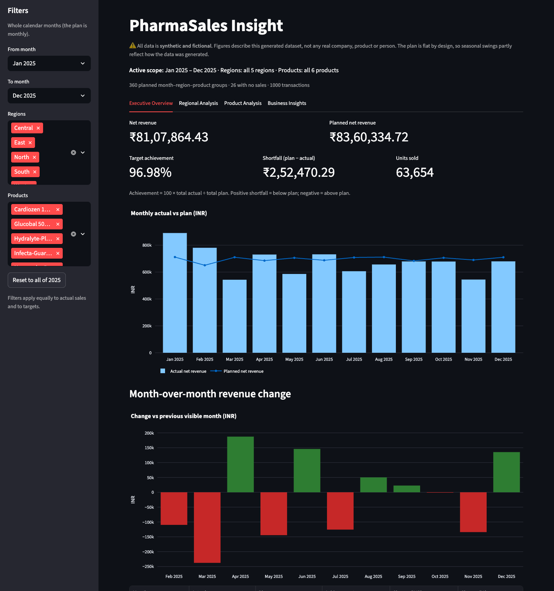
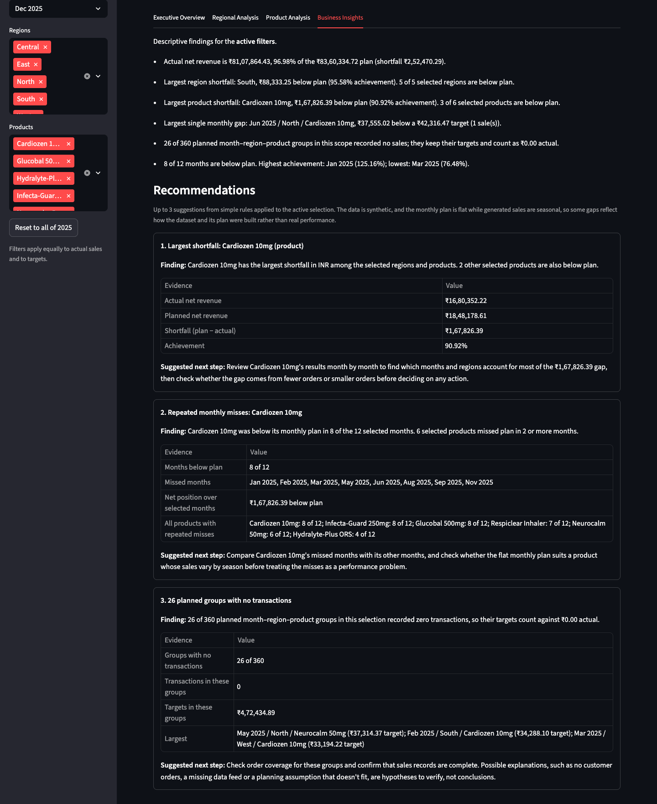

# PharmaSales Insight

A pharmaceutical sales analytics portfolio project: synthetic data → SQLite → SQL analysis →
Pandas analysis → an interactive Streamlit dashboard with data-backed recommendations.

> **Please read first**
> - **All data is synthetic and fictional.** The products, sales representatives, targets and
>   numbers are invented. They don't represent any real pharmaceutical company, product, market
>   or person.
> - **AI-assisted implementation.** The code was written with an AI coding assistant, working
>   checkpoint by checkpoint. The project author defined the requirements, reviewed each
>   checkpoint, and directed the fixes.
> - **Recommendations are suggested investigations**, generated by simple documented rules from
>   whatever data is selected. They're things to check, not conclusions about causes.



## Contents

- [Quick start](#quick-start)
- [How the project fits together](#how-the-project-fits-together)
- [The data](#the-data)
- [Two key design decisions](#two-key-design-decisions)
- [The dashboard](#the-dashboard)
- [Verification and tests](#verification-and-tests)
- [Project structure](#project-structure)
- [Limitations](#limitations)

## Quick start

Tested on macOS with Python 3.9.6. You need Python 3.9 or newer and Git. `sqlite3` is only
needed for the optional SQL commands; it's preinstalled on macOS and most Linux systems.

```bash
# 1. Get the code
git clone <repository-url> pharmasales-insight
cd pharmasales-insight

# 2. Create a virtual environment and install the pinned dependencies
python3 -m venv .venv
source .venv/bin/activate            # Windows: .venv\Scripts\activate
pip install -r requirements.txt

# 3. Check the included synthetic data (the CSV files and SQLite database are in the repository)
python src/validate_data.py

# 4. Launch the dashboard, then open http://localhost:8501
streamlit run src/dashboard.py
```

Regenerate the data (optional). This produces exactly the same files, because the random seeds are
fixed:

```bash
python src/generate_data.py
```

Run all the checks:

```bash
python -m unittest discover -s tests -v                                              # 113 Python tests
python src/analyze_sales.py                                                          # Pandas vs SQL reconciliation
sqlite3 -readonly -header -column data/pharma_sales.db < sql/checks/verify_checkpoint2.sql   # 21 SQL checks
sh sql/checks/run_boundary_tests.sh                                                  # SQL boundary tests
```

## How the project fits together

```
config.py ──► generate_data.py ──► data/pharma_sales.csv, data/sales_targets.csv
 (settings)    (fixed seeds)       data/pharma_sales.db  (tables: sales, sales_targets)
                                             │
              validate_data.py ◄─────────────┤  data-quality rules (Python) + CHECK rules (SQLite)
                                             │
              sql/analysis/*.sql ◄───────────┤  12 read-only business-question queries
              sql/checks/*       ◄───────────┤  21 reconciliation checks + boundary tests
                                             │
              analyze_sales.py   ◄───────────┤  Pandas analysis, verified against the SQL reports
                                             │
              dashboard_data.py ─► dashboard.py   Streamlit + Plotly (reads the DB read-only)
```

1. **Generate** (`src/generate_data.py`). This creates 1,000 fictional transactions for 2025 and a
   separate 360-row monthly target plan, using fixed random seeds. Before anything is saved, the
   data is checked. The files are written to temporary copies first and only swapped into place once
   they pass.
2. **Store** (`sql/schema.sql`). Both tables go into SQLite, with `CHECK` rules that reject bad
   rows: invalid dates, fractional units, revenue that doesn't match its formula, and a sales rep
   in the wrong region.
3. **Validate** (`src/validate_data.py`). This checks both copies of each table (CSV and database)
   and confirms the two copies match exactly.
4. **Analyse with SQL** (`sql/analysis/`). Twelve readable queries answer the business questions:
   totals, rankings, achievement against target, monthly trend, shortfalls, and a WHERE/HAVING
   teaching example.
5. **Analyse with Pandas** (`src/analyze_sales.py`). The same questions are recalculated in Pandas,
   then every number is checked against the SQL reports. Money must match to the paisa.
6. **Dashboard** (`src/dashboard.py`, `src/dashboard_data.py`). This reuses the verified Pandas code.
   It validates the whole year *before* applying any filter, then applies the same filter to sales
   and targets.

## The data

**`sales`**: one row per transaction (1,000 rows, 1 Jan–31 Dec 2025, INR).

| Column | Meaning |
|---|---|
| `transaction_id` | Unique ID, e.g. `TXN-00001` |
| `date` | `YYYY-MM-DD`, within 2025 |
| `region` | North, South, East, West, Central |
| `product` | 6 fictional products, e.g. Cardiozen 10mg, Respiclear Inhaler |
| `sales_rep` | 10 fictional reps, 2 per region |
| `channel` | Hospital, Retail Pharmacy, Clinic, Distributor |
| `units_sold`, `unit_price`, `discount_pct` | Whole units; INR per unit; discount as a fraction (0.10 = 10%) |
| `revenue` | Net revenue = `units_sold × unit_price × (1 − discount_pct)`, rounded to whole paise |
| `target_revenue` | *Legacy* per-order benchmark kept for compatibility. **Not used for KPIs.** |

**`sales_targets`**: one row per month + region + product (12 × 5 × 6 = **360 rows**), with
`target_net_revenue` (planned revenue after expected discounts). All 360 combinations exist,
**including 26 with no sales at all**.

**How the synthetic data is shaped.** Products follow different seasonal patterns (winter,
monsoon or summer peaks), regions differ in size, channels differ in order size and discount, and
each rep has a randomly drawn performance factor. The target plan is deliberately **flat** through
the year and never looks at the generated sales. Patterns in the dashboard therefore partly come
from these assumptions; they aren't real-world findings.

## Two key design decisions

### 1. A separate target table, joined without double-counting

A transaction and a monthly target describe different things: one row is a single order, the other
is a plan for a month, region and product. This is called having different **grains**.

If you join each monthly target to every matching transaction and then add up the targets, the
same target is counted once per transaction. For example, January / North / Cardiozen 10mg has a
₹45,103.83 target and 4 transactions. A naive join gives a target of **₹1,80,415.32**. Across the
whole year, the plan would come out at ₹2.49 crore instead of ₹83.6 lakh.

The project always does it in this order:

1. **Add up sales first**, giving one actuals row per month + region + product.
2. **Start from the target table** and `LEFT JOIN` the actuals on all three keys, so each target is
   used exactly once. In Pandas, `validate="one_to_one"` makes the merge fail if a key is
   duplicated.
3. **Treat missing actuals as 0** (`COALESCE(actual, 0)`). A planned group with no sales keeps its
   target and shows 0% achievement, instead of disappearing as it would with an `INNER JOIN`.

```sql
WITH monthly_actuals AS (
    SELECT SUBSTR(date, 1, 7) AS sales_month, region, product,
           SUM(CAST(ROUND(revenue * 100) AS INTEGER)) AS actual_paise
    FROM sales
    GROUP BY SUBSTR(date, 1, 7), region, product
)
SELECT t.target_month, t.region, t.product,
       CAST(ROUND(t.target_net_revenue * 100) AS INTEGER) AS target_paise,
       COALESCE(a.actual_paise, 0)                        AS actual_paise
FROM sales_targets AS t
LEFT JOIN monthly_actuals AS a
       ON a.sales_month = t.target_month AND a.region = t.region AND a.product = t.product;
```

`sql/analysis/10_inner_join_coverage_diagnostic.sql` shows all three versions side by side:
correct, INNER JOIN, and the naive join.

### 2. Money is compared in integer paise

Computers store decimals like 0.10 approximately, so `0.10 + 0.70` evaluates to
`0.7999999999999999`, which is *less than* 0.80. A group that met its target exactly could then be
labelled "below plan". Every amount is therefore converted to whole paise
(`CAST(ROUND(amount * 100) AS INTEGER)`, so ₹0.10 becomes 10) **before** anything is added up or
compared. Integers add up exactly (10 + 70 = 80). Amounts are turned back into rupees only for
display.

- A group that exactly meets its target is **at plan**.
- A group one paisa short is **below plan**, even if its achievement rounds to 100.00% on screen.

**Formulas used everywhere:**
- Achievement = 100 × total actual ÷ total plan. It's a ratio of totals, never an average of
  percentages, and shows as n/a if the plan is zero.
- Shortfall = plan − actual. Positive means below plan.
- Month-over-month growth: the INR change versus the previous visible month. The first month is
  n/a, and after a ₹0 month the percentage is n/a.

## The dashboard

```bash
streamlit run src/dashboard.py
```

- **Filters:** a From/To month range (whole calendar months), regions and products, plus **Reset to
  all of 2025**. The same filter is applied to sales and to targets, and the active scope is shown
  at the top of the page.
- **Executive Overview:** net revenue, plan, achievement, shortfall and units, a monthly actual-vs-
  plan chart, and month-over-month change.
- **Regional Analysis:** revenue, share of the selected revenue, plan, achievement and shortfall for
  each region.
- **Product Analysis:** revenue, units, average discount (a simple average across transactions),
  plan, achievement and shortfall.
- **Business Insights:** descriptive findings plus up to **three recommendations**, recalculated on
  every filter change. Each shows a **Finding**, the **Evidence** numbers and a **Suggested next
  step**. The rules are:
  1. **Largest shortfall:** the region or product furthest below plan in INR. An exact tie doesn't
     count; a one-paisa miss does.
  2. **Repeated monthly misses:** products below plan in 2 or more of the selected months. Skipped
     for a single-month view.
  3. **Planned groups with no transactions:** suggests checking order coverage and whether records
     are complete. Possible causes are presented as hypotheses.
  4. **Channel concentration:** one channel bringing in at least 40% of selected revenue, judged on
     actuals only. The plan has no channel targets, so channel achievement isn't available.

  If no rule applies, the tab shows "No recommendation rule applies to this selection."



**Error handling:** a missing, corrupt or unreadable database, missing tables, or invalid records
show a clear error with a fix, and no KPIs. Selecting no regions or no products shows an
explanatory message instead of zeros.

## Verification and tests

| Check | Command | What it proves |
|---|---|---|
| Data validation | `python src/validate_data.py` | Required fields, valid dates in 2025, positive whole units, valid discounts, allowed names, revenue formula, CSV and database identical |
| Python tests (113) | `python -m unittest discover -s tests -v` | Validation edge cases, safe saving, paise boundaries, growth rules, dashboard filters and errors (Streamlit AppTest), recommendation rules |
| Pandas vs SQL | `python src/analyze_sales.py` | Monthly, regional and product results match SQL reports 03/04/05/08 to the paisa |
| SQL checks (21) | `sqlite3 -readonly -header -column data/pharma_sales.db < sql/checks/verify_checkpoint2.sql` | Join returns 360 groups (26 with no sales); every rollup reconciles to the source totals |
| SQL boundary tests | `sh sql/checks/run_boundary_tests.sh` | ₹0.10 + ₹0.70 against ₹0.80 is at plan; a ₹0.01 miss is listed |

**Reference figures** for the full year (all regions, products and months):

| Net revenue | Planned net revenue | Achievement | Shortfall | Units | Transactions |
|---|---|---|---|---|---|
| ₹81,07,864.43 | ₹83,60,334.72 | 96.98% | ₹2,52,470.29 | 63,654 | 1,000 |

## Project structure

```
├── README.md
├── INTERVIEW_PREP.md            Interview preparation notes
├── requirements.txt             pandas, streamlit, plotly (pinned)
├── data/                        Synthetic data (committed; regenerate with generate_data.py)
│   ├── pharma_sales.csv
│   ├── sales_targets.csv
│   └── pharma_sales.db
├── docs/screenshots/            Dashboard screenshots used in this README
├── sql/
│   ├── schema.sql               Table definitions and CHECK rules
│   ├── analysis/                12 read-only business-question queries
│   └── checks/                  Verification checks, boundary test data, expected outputs
├── src/
│   ├── config.py                Shared settings and allowed names
│   ├── generate_data.py         Data generation and safe saving
│   ├── validate_data.py         Data-quality rules and report
│   ├── analyze_sales.py         Pandas analysis + SQL reconciliation
│   ├── dashboard_data.py        Dashboard data logic and recommendation rules
│   └── dashboard.py             Streamlit entry point (layout only)
└── tests/                       test_checkpoint1/3/4/5.py
```

## Limitations

- **Synthetic data.** All figures describe a generated dataset. Seasonality, region sizes and rep
  differences come from stated generation assumptions, so findings show what the generator built
  in, not real market behaviour.
- **Flat plan.** Targets ignore seasonality on purpose, so seasonal products look ahead of plan in
  their peak months and behind it in quiet months.
- **No rep or channel targets.** Rep and channel views show actual results only.
- **One year, one scale.** 1,000 transactions are enough to demonstrate the method, not to draw
  statistical conclusions.
- **Recommendations are rule-based prompts for investigation**, not causal analysis.
- **Local only.** The dashboard isn't deployed, and the dashboard has been checked in Chrome only.

## Technology

Python 3.9 · Pandas · SQLite · SQL · Streamlit · Plotly
